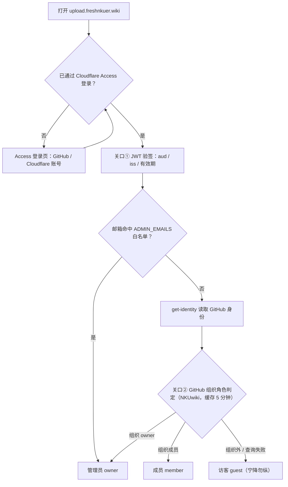
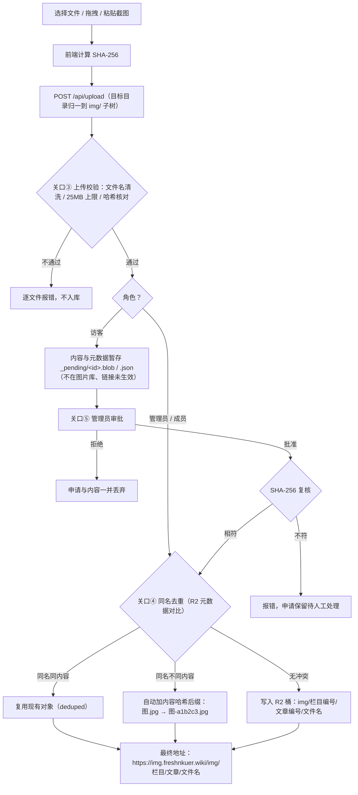
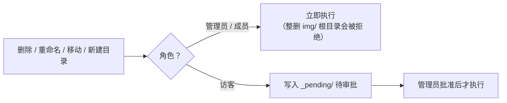

# NKUwiki 图片上传器

把文章图片传到对象存储（Cloudflare R2）的独立小工具，参考 [NCEPUwiki 的图片上传器](https://github.com/NCEPUwiki/ncepuwiki-image-uploader) 实现。它解决的是「图片放在哪」的问题：投稿人不再需要把图片塞进仓库或 PR，而是通过网页上传到图床；正文里继续写本地路径，主站构建时由 `replace-assets` 插件（参考 [Plume 主题的同名能力](https://theme-plume.vuejs.press/guide/features/replace-assets/)，实现位于 `packages/wiki-theme/lib/vite/replace-assets.ts`）统一改写为图床地址。

## 功能

- **网盘式浏览**：按目录浏览图库，图片网格预览、懒加载；
- **按文章编号归档**：上传时从主站仓库拉取「栏目 → 文章」目录树，选文章即自动落到 `img/栏目编号/文章编号/`（如 `docs/05.校园生活/09.美食.md` 的图存到 `img/05/09/`），与站内 `/img/...` 引用路径一一对应，也支持自定义目录；
- **多种上传方式**：选文件、选文件夹、拖拽、剪贴板粘贴，前端逐文件计算 SHA-256 后串行上传；
- **去重**：同目录同名且内容相同 → 复用现有文件；同名不同内容 → 文件名自动插入内容哈希短后缀（`图.jpg` → `图-b94d27.jpg`），同名文件永远指向同一内容，代理端可放心长缓存；
- **文件名清洗**：剔除路径分隔与 Windows 非法字符，中文文件名原样保留（与站内现有命名一致）；
- **审批流**：管理员（GitHub 组织 owner / 邮箱白名单）与成员的操作直接生效；其他登录者的上传、删除、移动、重命名、新建文件夹先进入 `_pending/` 待审批队列，由管理员在页面里批准或拒绝；
- **完整文件管理**：复制公开链接、重命名、移动、删除（目录递归）、新建文件夹；
- **无域名兜底**：`/img/*` 路由代理读桶（支持 ETag / 304），没绑自定义域名也能开箱即用。

桶键布局**镜像主站 `docs/public/` 的相对路径**（`img/05/09/美食.jpg`、`food/...`、favicon 等），这样站内 `/img/...` 引用经构建期替换后指向的 URL 与桶键一一对应。上传器把所有写入归一到 `img/` 子树；另有两组保留前缀：`_meta/`（目录树缓存等图床自身数据）与 `_pending/`（待审批申请），两者不出现在文件列表、也不允许通过任何接口读写。

## 角色与使用方法

入口：<https://upload.freshnkuer.wiki>，经 Cloudflare Access 登录（支持 GitHub 与 Cloudflare 账号）。登录后右上角徽章显示当前角色。

| 角色 | 判定条件 | 权限 |
| --- | --- | --- |
| 管理员 owner | GitHub 组织 owner，或邮箱命中 `ADMIN_EMAILS` | 直接生效 + 审批他人申请 |
| 成员 member | GitHub 组织成员 | 自己的操作直接生效 |
| 访客 guest | 其余通过 Access 登录者 | 一切改动进待审批队列 |

登录基于 Cloudflare Access（Zero Trust）：Worker 验签 `CF-Access-Jwt-Assertion`，再通过 Access 的 get-identity 换取 GitHub 身份并查询组织角色（结果缓存 5 分钟）。GitHub 查询失败时降级为访客，不会误放行。

> `REQUIRE_AUTH=false` 时不做任何鉴权，所有请求都按管理员处理——只适合本地开发或完全私有的内测环境。**部署到公网前务必先配好 Access 再改成 `true`**（生产当前已为 `true`）。

### 权限一览

| 操作 | 管理员 | 成员 | 访客 |
| --- | :-: | :-: | :-: |
| 浏览图片库、预览 | ✅ | ✅ | ✅ |
| 复制公开链接 | ✅ | ✅ | ✅ |
| 上传图片 | ✅ 立即生效 | ✅ 立即生效 | ⏳ 需审批 |
| 重命名 / 移动 / 新建目录 | ✅ | ✅ | ⏳ 需审批 |
| 删除 | ✅（`img/` 根目录受保护拒删） | ✅ | ⏳ 需审批 |
| 查看待审批列表 | ✅ 全部申请 | 仅自己的 | 仅自己的 |
| 批准 / 拒绝申请 | ✅ | ❌ | ❌ |

### 流程图：登录与角色判定



### 流程图：一张图片要过的关、最终到哪



### 流程图：管理操作（删除 / 重命名 / 移动 / 新建目录）



### 管理员（owner）

日常管理全部即时生效，无需等待审批：

- **上传**：点「上传图片 / 上传文件夹」，或直接把图片拖进页面、`Ctrl+V` 粘贴截图；在下拉里选中目标文章（自动归档到 `img/栏目编号/文章编号/`），也可选「自定义目录」手填路径；
- **复制链接**：图片卡片右上角「复制链接」，或点开图片详情复制——得到 `https://img.freshnkuer.wiki/img/...`，粘进正文即可；
- **整理**：详情弹窗里重命名 / 移动 / 删除（删除目录 = 递归删除，图片根目录 `img/` 受保护不可整删）；「新建文件夹」建目录；
- **审批**：右上角「待审批」徽标显示队列数量，点开逐条「批准 / 拒绝」——批准即真正执行，拒绝则丢弃申请；
- **兜底**：邮箱命中 `ADMIN_EMAILS` 的登录者恒为管理员，即使 GitHub 角色查询故障也能管理。

### 成员（member）

NKUwiki 组织成员，权限与管理员唯一的区别是**看不到他人的待审批队列、不能审批**：自己的上传 / 删除 / 移动 / 重命名全部即时生效。日常投稿流程与管理员相同。

### 访客（guest）

组织外投稿人，所有改动**不会立即生效**：

1. 登录后页面顶部有黄色提示条，说明当前处于「改动需审批」状态；
2. 正常上传 / 删除 / 移动 / 重命名——每一步都会提示「已提交待审批」，内容暂存在桶的 `_pending/` 保留区；
3. 管理员在「待审批」里批准后，文件才出现在图片库；**批准前请勿把链接写进 PR**——批准时若与现有文件重名，实际落盘文件名可能被自动加哈希后缀；
4. 申请人可在自己的「待审批」面板里查看队列状态（只能看到自己的申请）。

## 部署（Cloudflare）

前置条件：一个 Cloudflare 账号，主站域名托管在 Cloudflare（绑公开域名需要），GitHub 组织（角色判定用，可选）。

```bash
cd image-uploader
npm install            # 独立 npm 项目，不参与主仓库的 pnpm workspace
npx wrangler login
```

R2 桶名为 `nkuwiki`（自定义域 `img.freshnkuer.wiki` 已绑定其上；在控制台建桶绑域即可，`wrangler.toml` 的 `bucket_name` 与脚本都以此为单一事实来源）。编辑 `wrangler.toml` 的 `[vars]`（`IMAGE_BASE_URL`、`WIKI_REPO`、`GITHUB_ORG`、`ADMIN_EMAILS` 等，见下表），然后：

```bash
# 1. 把现有 docs/public 的静态资源镜像进桶（img/、food/、favicon 等 196 个对象，
#    跳过 CNAME 与 robots.txt；幂等可重跑，支持传前缀做增量）
node scripts/mirror-public.mjs
node scripts/mirror-public.mjs img/03   # 例：只补传某前缀

# 2. 可选但推荐：GitHub token，防 API 限流（catalog 拉取 + 角色查询）
npx wrangler secret put GITHUB_TOKEN

# 3. 接入 Cloudflare Access 后（REQUIRE_AUTH=true）必填：
npx wrangler secret put ACCESS_TEAM_DOMAIN   # 例：example.cloudflareaccess.com
npx wrangler secret put ACCESS_AUD           # Access 应用的 AUD 标签

# 4. 部署。自定义域在 wrangler.toml 的 routes 里声明（deploy 自动建 DNS 与证书），
#    workers_dev = false 保持不开公网 workers.dev 地址
npm run deploy
```

当前进度（2026-10-25）：**全链路已上线**。桶 `nkuwiki` 与公开域 `img.freshnkuer.wiki` 就绪（196 个对象已镜像）；Worker 部署在自定义域 <https://upload.freshnkuer.wiki>；Access 应用「upload」+ Allow Everyone 策略 + GitHub 登录方式均已生效，`REQUIRE_AUTH = true`。文章目录缓存（TTL 24h）已种入桶，Worker 拉 GitHub 失败时自动回退缓存；缓存过期后如需手动刷新，用 `scripts/fetch-catalog-once.ts`（见文件头注释的三条命令）。

注意：Cloudflare 会把不存在的对象的 404 也缓存最多 4 小时——迁移期间若 URL 404，加个查询串（如 `?v=2`）绕开缓存再验证。

### 公开访问域名（推荐）

Cloudflare Dashboard → R2 → `nkuwiki` → Settings → Public access → 绑定 Custom Domain（即 `img.freshnkuer.wiki`，已配置），`IMAGE_BASE_URL` 指向该域名。图片流量直达 R2 边缘缓存，不经过 Worker。

### 接入 Cloudflare Access（已接入）

已完成：Self-hosted 应用「upload」（域 `upload.freshnkuer.wiki`）+ Allow Everyone 策略；GitHub 登录方式（Zero Trust → Settings → Identity Providers → GitHub，对应 GitHub OAuth App `nkuwiki-access`，Callback `https://flat-water-9501.cloudflareaccess.com/cdn-cgi/access/callback`）；`REQUIRE_AUTH = true`；`ACCESS_TEAM_DOMAIN`（`flat-water-9501.cloudflareaccess.com`）与 `ACCESS_AUD` secret。注意 Cloudflare 表单里的 **App ID 就是 GitHub OAuth App 的 Client ID**（20 位十六进制串），别填成邮箱——填错时 GitHub 授权页会 404。

角色判定依赖 `GITHUB_TOKEN`（classic，勾 `read:org`）：token 失效时 GitHub 登录者一律按访客处理（改动进待审批），邮箱白名单 `ADMIN_EMAILS` 不受影响。若管理员徽章异常变访客，先检查 token：`wrangler secret put GITHUB_TOKEN` 重设。

## 配置项

| 变量 | 位置 | 说明 |
| --- | --- | --- |
| `IMAGE_BASE_URL` | vars | 公开图片域名（不带尾斜杠）。留空则用 Worker 自身域名的 `/img/*` 代理 |
| `REQUIRE_AUTH` | vars | `true` 强制 Access 登录并区分角色；`false` 全部视为管理员（仅内测） |
| `WIKI_REPO` | vars | 主站仓库，拉取文章目录树用，如 `NKUwiki/NKUwiki` |
| `GITHUB_ORG` | vars | GitHub 组织名，判定 owner / member |
| `ADMIN_EMAILS` | vars | 逗号分隔邮箱白名单，命中即 owner（不依赖 GitHub 查询） |
| `MAX_UPLOAD_MB` | vars | 单文件上限，默认 25 |
| `GITHUB_TOKEN` | secret | 可选；防 GitHub API 限流 |
| `ACCESS_TEAM_DOMAIN` / `ACCESS_AUD` | secret | `REQUIRE_AUTH=true` 时必填 |
| `BUCKET` | R2 绑定 | 图片桶 |

## 与主站构建的配合

桶键与 `docs/public/` 完全同构，所以**正文里的写法完全不变**（``）。要把资源流量切到图床时：

```bash
WIKI_ASSETS_BASE=https://img.freshnkuer.wiki pnpm build
```

构建产物里所有指向本地静态资源的链接（HTML/CSS/JS 里的 `/img/...`、`/food/...`、favicon 等）会被改写到该域名，与桶键一一对应；不设该变量时产物逐字节不变。本地 `pnpm dev` 始终读 `docs/public`，两边可以并行存在，迁移与回滚都只是环境变量的事。

注意切换后 `CNAME`、`robots.txt`、`manifest.webmanifest` 与 `og:image`（使用站点绝对地址）仍由 GitHub Pages 直出——它们本来就不在替换范围内，桶里不存也不影响。切换前先用 `mirror-public.mjs` 把仓库里最新的 `docs/public` 镜像进桶（之后新增图片走上传器，或定期重跑脚本补齐）。

## 本地开发

```bash
npm run dev        # wrangler dev，R2 走本地模拟，http://localhost:8787/
npm run typecheck  # tsc --noEmit
```

本地开发无需任何密钥（`REQUIRE_AUTH=false`）。核心纯函数（文件名清洗、编号分层解析、去重命名）位于 `src/util.ts`，由主仓库的 `tests/uploader-util.test.ts` 覆盖，`pnpm test` 一并运行。

## 目录结构

```text
image-uploader/
├── wrangler.toml        # 部署配置：R2 绑定、vars、workers_dev 开关
├── .dev.vars.example    # 本地开发密钥模板（.dev.vars 不入库）
├── package.json         # 独立 npm 项目（wrangler / typescript）
├── scripts/
│   ├── mirror-public.mjs     # docs/public → R2 桶镜像上传（幂等，支持前缀增量）
│   └── fetch-catalog-once.ts # 文章目录缓存手动刷新（Worker 出口被 GitHub 限流时用）
└── src/
    ├── index.ts         # Worker 入口：/（UI）、/api/*、/img/* 代理（路径↔键 1:1）
    ├── api.ts           # JSON 接口：列表、上传、文件操作、审批
    ├── auth.ts          # Access JWT 验签 + GitHub 组织角色判定
    ├── catalog.ts       # 从 GitHub 拉文章目录树（R2/内存双层缓存）
    ├── storage.ts       # R2 操作：列目录、去重上传、增删改、_pending 审批
    ├── types.ts         # Env 与共享类型
    ├── ui.ts            # 单页 UI（内联 HTML/CSS/JS，无外部依赖）
    └── util.ts          # 纯函数：文件名清洗、编号分层、去重命名、img/ 归一
```
