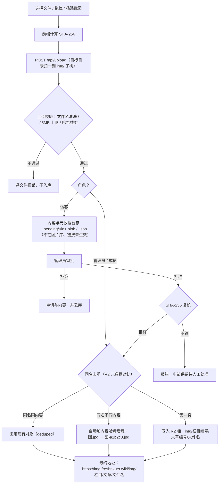

# NKUwiki 图片上传器

把文章图片传到对象存储（Cloudflare R2）的独立小工具，参考 [NCEPUwiki 的图片上传器](https://github.com/NCEPUwiki/ncepuwiki-image-uploader) 实现。它解决的是「图片放在哪」：投稿人不必把图片塞进仓库或 PR，而是通过网页上传到图床；正文里继续写本地路径，主站构建时由 `replace-assets` 插件（参考 [Plume 主题的同名能力](https://theme-plume.vuejs.press/guide/features/replace-assets/)，实现位于 `packages/wiki-theme/lib/vite/replace-assets.ts`）统一改写为图床地址。

## 功能

- **网盘式浏览**：按目录浏览图库，网格预览、懒加载；支持复制公开链接、重命名、移动、递归删除、新建文件夹；
- **按文章编号归档**：上传时从主站仓库拉取「栏目 → 文章」目录树，选文章即落到 `img/栏目编号/文章编号/`（如 `docs/05.校园生活/09.美食.md` → `img/05/09/`），与站内 `/img/...` 引用路径一一对应，也可手填自定义目录；
- **多种上传方式**：选文件、选文件夹、拖拽、剪贴板粘贴，前端逐文件算 SHA-256 后串行上传；
- **去重**：同目录同名同内容 → 复用现有对象；同名不同内容 → 文件名自动插入内容哈希短后缀（`图.jpg` → `图-b94d27.jpg`），同名文件永远指向同一内容，代理端可放心长缓存；
- **文件名清洗**：剔除路径分隔与 Windows 非法字符，中文原样保留；
- **审批流**：管理员、成员的操作直接生效；其他登录者的上传与增删改先进入 `_pending/`，由管理员批准或拒绝；
- **无域名兜底**：`/img/*` 路由代理读桶（支持 ETag / 304），没绑自定义域名也能用。

桶键布局**镜像主站 `docs/public/` 的相对路径**（`img/05/09/美食.jpg`、`food/...`、favicon 等），站内 `/img/...` 引用经构建期替换后指向的 URL 与桶键一一对应。上传器把所有写入归一到 `img/` 子树；另有两组保留前缀：`_meta/`（目录树缓存等图床自身数据）与 `_pending/`（待审批申请），两者不出现在文件列表、也不允许通过任何接口读写。

## 角色与权限

入口：<https://upload.freshnkuer.wiki>，经 Cloudflare Access 登录（GitHub 或 Cloudflare 账号均可）。登录后右上角徽章显示当前角色。

| 角色 | 判定条件 | 权限 |
| --- | --- | --- |
| 管理员 owner | GitHub 组织 owner，或邮箱命中 `ADMIN_EMAILS` | 直接生效 + 审批他人申请 |
| 成员 member | GitHub 组织成员 | 自己的操作直接生效，看不到他人排队、不能审批 |
| 访客 guest | 其余通过 Access 登录者 | 一切改动进待审批队列 |

| 操作 | 管理员 | 成员 | 访客 |
| --- | :-: | :-: | :-: |
| 浏览图片库、预览、复制链接 | ✅ | ✅ | ✅ |
| 上传图片 | ✅ 立即生效 | ✅ 立即生效 | ⏳ 需审批 |
| 重命名 / 移动 / 新建目录 | ✅ | ✅ | ⏳ 需审批 |
| 删除 | ✅（`img/` 根目录受保护拒删） | ✅ | ⏳ 需审批 |
| 查看待审批列表 | ✅ 全部申请 | 仅自己的 | 仅自己的 |
| 批准 / 拒绝申请 | ✅ | ❌ | ❌ |

登录基于 Cloudflare Access：Worker 验签 `CF-Access-Jwt-Assertion`（aud / iss / 有效期），先看邮箱白名单，再用 Access 的 get-identity 换 GitHub 身份查询组织角色（缓存 5 分钟）。**GitHub 查询失败一律降级为访客**，不会误放行。

> `REQUIRE_AUTH=false` 时不做任何鉴权，所有请求都按管理员处理——只适合本地开发或完全私有的内测环境。**部署到公网前务必先配好 Access 再改成 `true`**（生产当前已为 `true`）。

## 上传流程



访客注意：**批准前不要把链接写进 PR**——批准时若与现有文件重名，实际落盘文件名可能被自动加哈希后缀。

## 部署（Cloudflare）

前置条件：Cloudflare 账号、主站域名托管在 Cloudflare（绑公开域名需要），GitHub 组织（角色判定用，可选）。桶名为 `nkuwiki`，自定义域 `img.freshnkuer.wiki` 已绑定其上。

```bash
cd image-uploader
npm install            # 独立 npm 项目，不参与主仓库的 pnpm workspace
npx wrangler login

# 1. 把现有 docs/public 的静态资源镜像进桶（跳过 CNAME 与 robots.txt；
#    幂等可重跑，支持传前缀做增量）
node scripts/mirror-public.mjs
node scripts/mirror-public.mjs img/03   # 例：只补传某前缀

# 2. 可选但推荐：GitHub token，防 API 限流（catalog 拉取 + 角色查询）
npx wrangler secret put GITHUB_TOKEN

# 3. 接入 Access 后（REQUIRE_AUTH=true）必填：
npx wrangler secret put ACCESS_TEAM_DOMAIN   # 例：example.cloudflareaccess.com
npx wrangler secret put ACCESS_AUD           # Access 应用的 AUD 标签

npm run deploy         # 自定义域在 wrangler.toml 的 routes 里声明，deploy 自动建 DNS 与证书
```

状态（2026-10-25）：**全链路已上线**——桶 `nkuwiki` 与公开域就绪（196 个对象已镜像），Worker 跑在 `upload.freshnkuer.wiki`，Access 应用「upload」+ Allow Everyone 策略生效，`REQUIRE_AUTH = true`；文章目录缓存（TTL 24h）已种入桶，Worker 拉 GitHub 失败时回退缓存，手动刷新用 `scripts/fetch-catalog-once.ts`。

两个踩过的坑：

- Cloudflare 会把不存在的对象的 404 也缓存最多 4 小时——迁移期间若 URL 404，加查询串（如 `?v=2`）绕开缓存再验；
- 配 GitHub 登录时，Cloudflare 表单里的 **App ID 就是 GitHub OAuth App 的 Client ID**（20 位十六进制），填成邮箱会让 GitHub 授权页 404。

角色判定依赖 `GITHUB_TOKEN`（classic，勾 `read:org`）：token 失效时 GitHub 登录者一律按访客处理，邮箱白名单 `ADMIN_EMAILS` 不受影响。管理员徽章异常变访客时，先 `wrangler secret put GITHUB_TOKEN` 重设。

## 配置项

| 变量 | 位置 | 说明 |
| --- | --- | --- |
| `IMAGE_BASE_URL` | vars | 公开图片域名（不带尾斜杠）。留空则用 Worker 自身域名的 `/img/*` 代理 |
| `REQUIRE_AUTH` | vars | `true` 强制 Access 登录并区分角色；`false` 全部视为管理员（仅内测） |
| `WIKI_REPO` | vars | 主站仓库，拉取文章目录树用，如 `NKUwiki/NKUwiki` |
| `GITHUB_ORG` | vars | GitHub 组织名，判定 owner / member |
| `ADMIN_EMAILS` | vars | 逗号分隔邮箱白名单，命中即 owner（不依赖 GitHub 查询） |
| `MAX_UPLOAD_MB` | vars | 单文件上限，默认 25 |
| `GITHUB_TOKEN` | secret | 可选；防 GitHub API 限流 |
| `ACCESS_TEAM_DOMAIN` / `ACCESS_AUD` | secret | `REQUIRE_AUTH=true` 时必填 |
| `BUCKET` | R2 绑定 | 图片桶 |

## 与主站构建的配合

桶键与 `docs/public/` 同构，所以**正文里的写法永远不变**（``）。改写由主站的 `replace-assets` 插件完成，开关只有一个环境变量：

```bash
WIKI_ASSETS_BASE=https://img.freshnkuer.wiki pnpm build   # 本地复现线上：资源走图床
# 不设置 = 插件空转，产物逐字节不变（本地预览默认如此）→ 回滚也只是去掉变量重新构建
```

生产已于 2026-10-25 启用：变量写在 `.github/workflows/static.yml` 的 **job 级 `env:`**（构建与图床验活共用一份，避免两处写同一个域名），**删掉那一行再 push 即完整回退**。它不能改放到 `docs/.env`——`.env` 只喂 `VITE_` 前缀、且只进 `import.meta.env`，而 `config.mts` 读的是 `process.env`，写过去会被静默忽略、构建照常成功但功能没开。

插件有两个入口，缺一不可：`generateBundle` 处理打包产物里的 JS / CSS，`transformHtml` 补最终 HTML（`<head>` 里的 favicon、字体预加载在 bundle 之后才拼出来）。什么会被改、什么不会：

| 产物里的路径 | 是否改写 | 原因 |
| --- | :-: | --- |
| `/img/…`、`/food/…`、`/map/…`、`/favicon-*.svg` 等图片与媒体 | ✅ | 桶键与路径 1:1，改写后直达 R2 |
| 打包后 JS 里被压成模板字面量的同一批路径（`` `/food/shots/x.webp` ``） | ✅ | 前导字符认 `"` `'` `` ` `` 和 `(`；压缩器会把源码的单引号改写成反引号，只认前两种会漏掉整批（实测漏 180 个真实资源） |
| `/assets/inter-*.woff2` 等构建产物 | ❌ | 文件名带构建哈希，每次构建都变，桶里追不平；由 Pages 直出（`skip: '^/assets/'`） |
| `manifest.webmanifest` 里的图标路径 | ❌ | 该文件在 `docs/public` 下，public 是原样拷贝、不经过 rollup，插件看不到（与 `CNAME` / `robots.txt` 同理）。文件一直在站内，不影响 |
| `.css` / `.js` / 页面路径 | ❌ | 只匹配图片与媒体扩展名 |
| `og:image` 这类带域名的绝对地址 | ❌ | 插件只认以 `/` 开头的站内路径 |
| `CNAME` / `robots.txt` | ❌ | 页面不引用 |

两个容易踩的点：

1. **不要改成「只改写 `docs/public` 里存在的文件」**。本站允许图片只存在于图床（正文照样写 `/img/...`，仓库里不放），那种引用必须照改不误，否则生产页直接 404；
2. **示例路径别写成真路径**。文档、UI 占位符里演示写法时用 ``、`/map/pic/xxx` 这类占位，写成 `/img/xx.png`、`/map/pic/xxx.png` 会被当成真资源一起改写到图床（已按此清掉 6 处）。

### 桶必须配 CORS，并让分享长图绕开浏览器缓存

两件事缺一不可——**只配 CORS 仍然会失败**：

1. **桶上要有 CORS 规则**（`cors.json`：`*` 来源 + GET/HEAD）。跨域 `fetch` 要读响应体必须有 `Access-Control-Allow-Origin`，否则 `share-image.ts` 逐张把图取成 data URL 时全部被拦；
2. **分享长图的 fetch 必须带 `cache: 'reload'`**。modern-screenshot 默认 `cache: 'force-cache'`，而图片此刻已经被 `` 以 no-cors 方式取过、躺在浏览器缓存里；Chromium 不会为这份不透明副本补 CORS 校验，于是默认模式必失败。实测同一个 URL：默认模式 3/3 失败，`cache:'reload'` 3/3 成功，加随机查询串也成功——所以这是缓存问题，不是桶的问题。

失败是**静默**的：modern-screenshot 的 `runTask` 会吞掉单张图的异常，`placeholderImage` 里那句 `throw` 根本到不了用户面前，表现是长图里某些图片凭空消失、还不报错。别指望错误提示，要靠这两条前置条件兜住。

已应用（2026-10-25）：`npx wrangler r2 bucket cors set nkuwiki --file cors.json`。复核：

```bash
curl -s -D - -o /dev/null -H "Origin: https://freshnkuer.wiki" \
  https://img.freshnkuer.wiki/favicon-light.svg | grep -i access-control
```

一个缓存注意事项：规则生效**之前**被缓存的副本仍不带 CORS 头（`cf-cache-status: HIT` 也可能是旧的），最多 4 小时自然过期。要立刻一致就在 Cloudflare 面板 Purge Everything——wrangler 的 OAuth token 没有 cache purge 权限。

实测（2026-10-25，最终版）：带 `WIKI_ASSETS_BASE` 完整构建后，产物共 **1017 处、188 个唯一**图床地址，HEAD+GET 逐一请求全部 200；753 处在 HTML、264 处在打包后的 JS；`/assets/` 下无一条指向图床；代码块里没有一条示例路径被误改。端到端：用 `vitepress preview` 起这份产物、Edge 打开兴趣群页点「生成分享PDF」，长图 1920×8435 生成成功、图床图片 0 失败（修复前同一操作有 3 张图被拦）。

### 图片同步：两道保险

插件是**无条件改写**（这是为了支持「图片只存图床、仓库不放」），所以「仓库有图、桶里没有」不会被构建发现——`pnpm dev` 根本不跑插件（`apply: 'build'`），`pnpm build` 也照常成功，只有线上是 404。两道保险：

1. **闸门（已启用，零密钥）**：CI 在构建之后、上传产物之前跑 `docs/.vitepress/scripts/check-cdn-assets.mjs`，把产物里每个图床地址 HEAD 一遍（188 条约 10 秒，8 并发；HEAD 不被支持时退回 `Range: bytes=0-0` 的 GET）。main 上有取不到的就**直接失败、不部署**，线上保持旧版本；PR 只打 warning（贡献者没有桶的写权限，硬卡会让人无从下手）。本地等价命令：`pnpm check:cdn`。
2. **自动镜像（可选）**：配了两个 secret 后，CI 在构建前跑 `npm ci && node scripts/mirror-public.mjs`，加图不必再手动补传。

配 secret（`Settings → Secrets and variables → Actions`）：

| Secret | 取值 |
| --- | --- |
| `CLOUDFLARE_API_TOKEN` | My Profile → API Tokens，需要 R2 读写权限 |
| `CLOUDFLARE_ACCOUNT_ID` | 控制台域名概览页右侧的 Account ID |

没配也能正常跑：同步步骤打印一行提示后跳过，缺图交给闸门拦。

手动补传（本机需先 `wrangler login`）：

```bash
cd image-uploader
node scripts/mirror-public.mjs             # 全量（幂等，同名覆盖）
node scripts/mirror-public.mjs img/05      # 只补某个前缀（增量）
```

本地自查，等同 CI 那道闸门：

```bash
WIKI_ASSETS_BASE=https://img.freshnkuer.wiki pnpm build
pnpm check:cdn
```

## 本地开发

```bash
npm run dev        # wrangler dev，R2 走本地模拟，http://localhost:8787/
npm run typecheck  # tsc --noEmit
```

本地开发无需任何密钥（`REQUIRE_AUTH=false`）。测试放在本项目的 `tests/`（`util.test.ts` 覆盖纯函数、`storage.test.ts` 用内存版 R2 覆盖存储层与审批流），在仓库根目录执行 `pnpm test` 一并运行——根目录的 `tests/` 只放站点工程的测试，上传器的测试跟着它自己的项目走，免得把 Cloudflare 的全局类型(`R2Bucket` 等)带进站点工程的 typecheck。

## 目录结构

```text
image-uploader/
├── wrangler.toml        # 部署配置：R2 绑定、vars、workers_dev 开关
├── cors.json            # R2 桶 CORS 规则（切图床前必须 set，否则长图导出失败）
├── .dev.vars.example    # 本地开发密钥模板（.dev.vars 不入库）
├── package.json         # 独立 npm 项目（wrangler / typescript）
├── tests/               # util 与 storage 的测试（在仓库根目录用 pnpm test 跑）
├── scripts/
│   ├── mirror-public.mjs     # docs/public → R2 桶镜像上传（幂等，支持前缀增量）
│   └── fetch-catalog-once.ts # 文章目录缓存手动刷新（Worker 出口被 GitHub 限流时用）
└── src/
    ├── index.ts         # Worker 入口：/（UI）、/api/*、/img/* 代理（路径↔键 1:1）
    ├── api.ts           # JSON 接口：列表、上传、文件操作、审批
    ├── auth.ts          # Access JWT 验签 + GitHub 组织角色判定
    ├── catalog.ts       # 从 GitHub 拉文章目录树（R2/内存双层缓存）
    ├── storage.ts       # R2 操作：列目录、去重上传、增删改、_pending 审批
    ├── types.ts         # Env 与共享类型
    ├── ui.ts            # 单页 UI（内联 HTML/CSS/JS，无外部依赖）
    └── util.ts          # 纯函数：文件名清洗、编号分层、去重命名、img/ 归一
```
